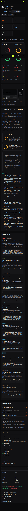

<div align="center">


# Looi — the 24/7 AI marketing agent

**Paste a URL. Looi markets it until it hits.**

Real site audit · production-grade animated video ads · one-click auto-publishing · re-checks every 2–3 hours and changes strategy on its own.

[](LICENSE)
[](DEPLOY.md)
[](https://github.com/jangidpranshu1989-create/looi/releases/latest)


</div>

## Why Looi

Most "AI marketing" tools write a caption and stop. Looi takes a **mission**: make your product a hit, and keeps working on it around the clock.

1. **Deep site audit (no fake numbers).** Real Lighthouse on mobile and desktop, Core Web Vitals, SEO, security headers, broken links, tech stack, accessibility and an AI UI/UX review of a real screenshot of your live site.
2. **Production ads from your real product.** Looi captures your actual UI, brand colours and fonts, writes angles and hooks, and renders frame-accurate animated MP4 ads (square, story, landscape) plus posters — in Chromium + FFmpeg, no stock templates.
3. **Auto-publish.** One-click plugins (via [Composio](https://composio.dev)) for X, LinkedIn, Facebook, Instagram, Reddit, Slack, Discord, Telegram, Gmail and 1,000+ apps. Every post carries a tracked link.
4. **24/7 loop.** Every 2–3 hours Looi re-measures your site, reads post metrics and clicks, and decides: scale, iterate, or **pivot** to a new route (new angle, format, channel, Product Hunt / Reddit / Hacker News launch kit, cold email, or site fixes that block conversion).
5. **You stay in control.** Approval mode with a live "running" pill and push notifications, or full autopilot.

| Ads | Site report | Mobile |
|---|---|---|
|  |  |  |

## Use it

- **Looi Free (₹0)** — deploy on the Cloudflare free plan in 5 minutes ([DEPLOY.md](DEPLOY.md)). Users install the APK or open the web app and paste a URL; Looi AI and one-click plugins are included, no keys.
- **Looi Cloud** — sign up, paste a URL. Looi AI is included, no API keys. 7-day free trial, then Free / Pro / Scale.
- **Android app** — [download the APK](https://github.com/jangidpranshu1989-create/looi/releases/latest). Runs on Looi Cloud by default; *Advanced → Run on this phone* turns the phone itself into the agent (your own free Groq / NVIDIA NIM key, no server at all).
- **Self-host** — it's open source. One Docker container.

## Plans (Looi Cloud)

| | Trial (7 days) | Free | Pro | Scale |
|---|---|---|---|---|
| Missions | 2 | 1 | 5 | 25 |
| Site audits / 30 days | 4 | 2 | 40 | 200 |
| Video ads / 30 days | 24 | 6 | 200 | 1,000 |
| Re-check interval | 2.5 h | 12 h | 2 h | 1 h |
| Autopilot publishing | yes | – | yes | yes |
| Price | ₹0 | ₹0 | ₹999 / 30 days | ₹2,999 / 30 days |

Pay with any UPI app (deep link or QR to `8529418454@fam`), then submit the 12-digit UTR. Access starts right away and is confirmed after the payment is matched. No auto-renew.

Support: [jangid.pranshu1989@gmail.com](mailto:jangid.pranshu1989@gmail.com) · WhatsApp [+91 85294 18454](https://wa.me/918529418454)

## Deploy free (Cloudflare free plan)

1. Free Cloudflare account → API token (template "Edit Cloudflare Workers" + Workers KV Storage edit) + Account ID.
2. Repo secrets: `CLOUDFLARE_API_TOKEN`, `CLOUDFLARE_ACCOUNT_ID`, `NVIDIA_API_KEY`, `GROQ_API_KEY`, `COMPOSIO_API_KEY`.
3. Actions → **Deploy to Cloudflare (Free)**. The signed APK is rebuilt to point at your Worker.

Full guide and limits: [DEPLOY.md](DEPLOY.md).

## Optional: paid Looi Cloud (Cloudflare Containers)

Looi runs on **Cloudflare**: the web app is served from the edge, the API + 24/7 agent + Chromium/FFmpeg renderer run in an always-on [Cloudflare Container](https://developers.cloudflare.com/containers/), the database and media are kept in **R2**, and a cron trigger keeps the agent awake.

1. Cloudflare account → Workers **Paid** plan ($5/mo).
2. Create an API token (template "Edit Cloudflare Workers", plus R2 and Containers edit) and copy your Account ID.
3. Repo → Settings → Secrets → Actions: `CLOUDFLARE_API_TOKEN`, `CLOUDFLARE_ACCOUNT_ID`, and the app keys below.
4. Actions → **Deploy to Cloudflare** → Run workflow. Every push to `main` redeploys.

| Secret | Where to get it | Required |
|---|---|---|
| `NVIDIA_API_KEY` | [build.nvidia.com](https://build.nvidia.com) | primary brain |
| `GROQ_API_KEY` | [console.groq.com/keys](https://console.groq.com/keys) | instant failover |
| `OPENAI_API_KEY` / `LOOI_AI_BASE_URL` + `LOOI_AI_KEY` | any OpenAI-compatible API | optional |
| `COMPOSIO_API_KEY` | [platform.composio.dev](https://platform.composio.dev) | for publishing |
| `PSI_API_KEY` | [Google PageSpeed API](https://developers.google.com/speed/docs/insights/v5/get-started#APIKey) | recommended |
| `ADMIN_EMAILS` | your email(s), comma separated (unlimited plan + payment verification) | yes |

AI failover: NVIDIA NIM is tried first; any error, timeout (45 s) or empty answer switches to Groq instantly and NIM is skipped for 3 minutes. Order is configurable with `LOOI_AI_ORDER`.

Full guide: [DEPLOY.md](DEPLOY.md).

### Docker anywhere (VPS, Railway, Fly, Coolify)

```bash
cp .env.example .env   # fill in keys
docker build -t looi .
docker run -d --restart=always -p 5000:5000 --env-file .env -v looi-data:/app/looi-data looi
```

Give it at least 2 GB RAM — real Chromium + FFmpeg rendering is the point.

### Local development

```bash
npm install
npm run dev            # http://localhost:5000  (tables are created automatically)
```

Requires Chromium (`CHROME_PATH` if not auto-detected) and `ffmpeg` on PATH. Without `LOOI_SAAS=1` it runs single-user and you add your own AI key in Settings.

### Android / iOS

```bash
npm run build
cd native && npm install
LOOI_CLOUD_URL=https://your-looi-domain node scripts/sync-web.mjs
npx cap add android && node scripts/patch-android.mjs   # first time only
npx cap sync android && cd android && ./gradlew assembleRelease
```

The GitHub Actions workflow `android.yml` builds and publishes a signed APK on every `v*` tag (set the `LOOI_CLOUD_URL` repository variable and the `ANDROID_KEYSTORE_*` secrets).

## Architecture

| Part | Path | Notes |
|---|---|---|
| Web app (React, Vite, Tailwind, shadcn/ui) | `client/` | Landing, auth, dashboard, missions, approvals, channels, billing, settings. |
| API + agent (Express, SQLite) | `server/` | Auth, plans and quotas (`billing.ts`), scheduler, priority job queue. |
| Agent modules | `server/agent/` | `analyze.ts` audit · `render.ts` MP4 ad renderer · `composio.ts` plugins · `publish.ts` · `llm.ts` Looi AI chain (NVIDIA NIM → instant Groq failover → OpenAI-compatible) · `agent.ts` mission loop + strategist. |
| On-device agent | `client/src/local/` | The same agent running inside the phone (IndexedDB, PSI, WebCodecs). |
| Native shell (Capacitor) | `native/` | Android/iOS, OS background runner, local notifications, approvals. |

## Contributing

PRs are welcome — see [CONTRIBUTING.md](CONTRIBUTING.md). Good first areas: new ad templates in `server/agent/render.ts`, new launch playbooks, translations.

## License

[AGPL-3.0](LICENSE). You can use, modify and self-host Looi freely. If you run a modified version as a public service, you must publish your changes.
